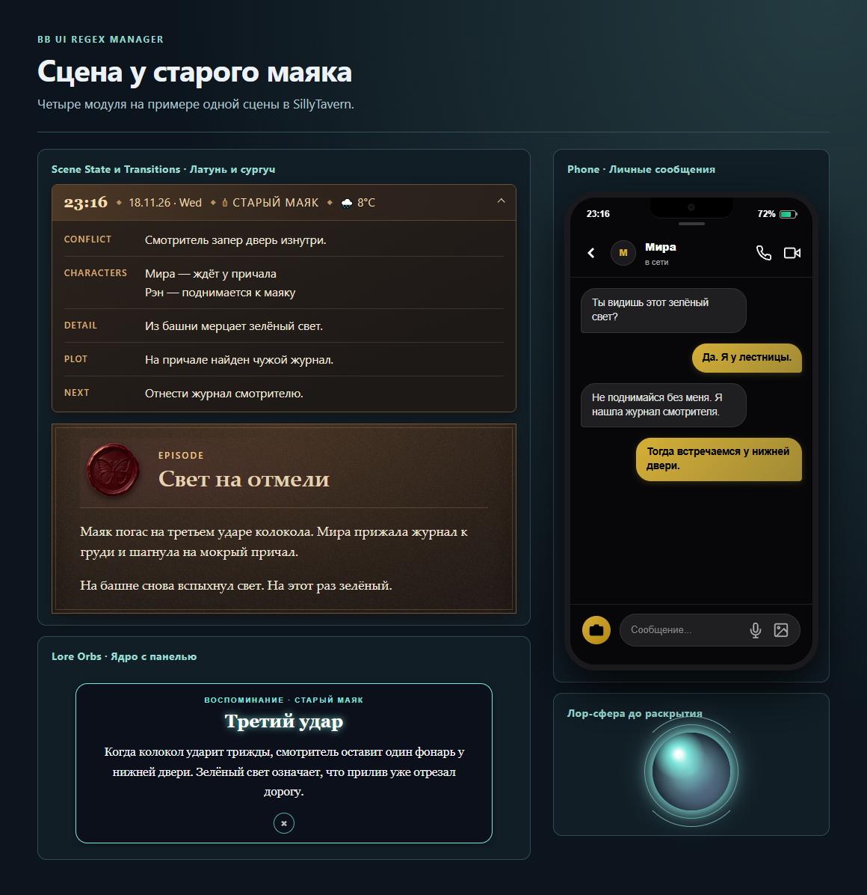
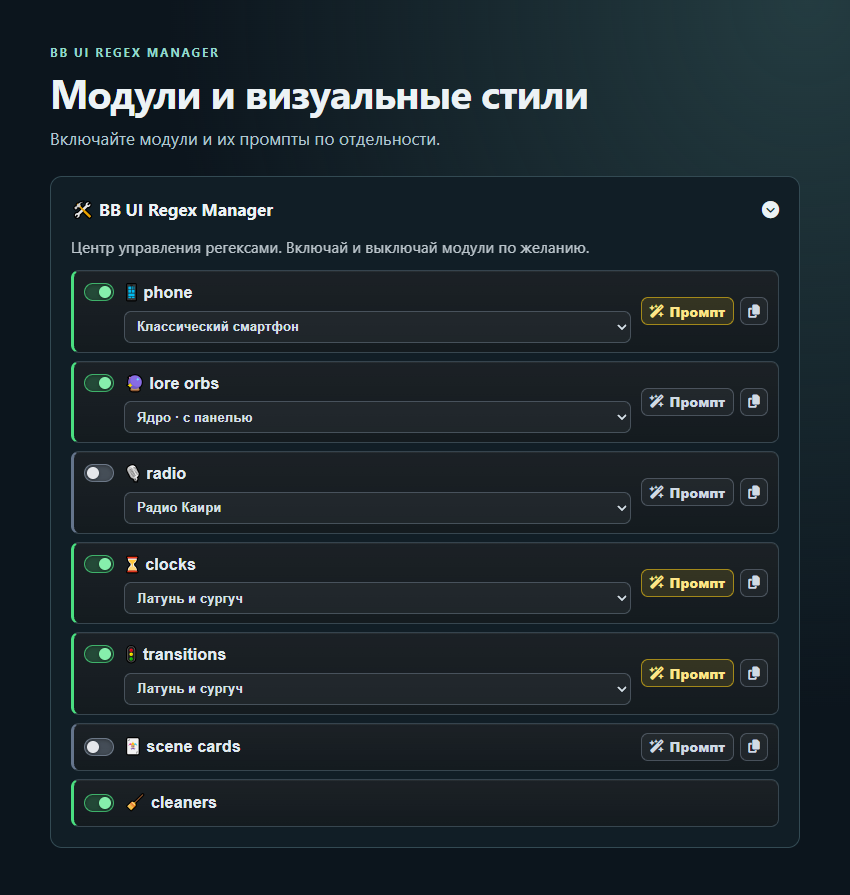

<div align="center">

# 🧩 BB UI Regex Manager

**Добавьте в ролевой чат SillyTavern сообщения на телефоне, состояние сцены и фрагменты лора.**

[Установка](#-установка) · [Быстрый старт](#-быстрый-старт) · [Модули](#-модули) · [История изменений](CHANGELOG.md)

</div>

---

Расширение собирает визуальные regex-модули в одной панели. Вы выбираете, какие блоки появятся в ответах модели, и задаёте стиль каждого модуля.

> После установки откройте **Расширения → BB UI Regex Manager**.



*Демо-сцена отрисована из regex-шаблонов пакета.*

## 🎛️ Модули

| Модуль | Что появится в чате |
| --- | --- |
| **Phone** | Смартфон с лентой, постами, историями, личными сообщениями, новостями и уведомлениями. |
| **Lore Orbs** | Интерактивная сфера, которая раскрывает слух, воспоминание или короткую деталь мира. |
| **Radio** | Виджет радио или подкаста с текстом эфира. |
| **Scene State** (`clocks`) | Сворачиваемая панель с датой, временем, местом, погодой, персонажами и текущими событиями сцены. |
| **Transitions** | Разделители, заголовки сцен и эпизодов, блоки для шёпота, мыслей и воспоминаний. |
| **Scene Cards** | Карточки для иллюстраций к комедийным, драматическим, романтическим сценам и хоррору. |
| **Cleaners** | Скрытие reasoning-блоков, исправление HTML и преобразование отдельных текстовых паттернов. |

### Варианты оформления

- **Phone** — классический смартфон или KimetsuPhone.
- **Lore Orbs** — «Призма» и «Ядро», каждый стиль с панелью или без неё.
- **Radio** — радио Каири, радио Акико и Lo-Fi Podcast Лона.
- **Scene State** и **Transitions** — «Классическое стекло», «Красно-золотой», «Пыльная роза», «Хроники Сильвера» и «Латунь и сургуч». Стиль выбирается отдельно для каждого модуля.

В стиле **«Латунь и сургуч»** эпизоды отмечены печатью с бабочкой, шёпот выделен винным фоном, а воспоминания оформлены в сепии. Нажатие на плашку времени раскрывает детали сцены.

## 📦 Установка

1. Откройте **Расширения → Установить расширение** в SillyTavern.
2. Вставьте адрес репозитория:

   ```text
   https://github.com/maxkara14/BB-UI-Regex-Pack
   ```

3. Подтвердите установку и обновите страницу.

Для автоматической генерации изображений из тегов `data-iig-instruction` установите [sillyimages](https://github.com/0xl0cal/sillyimages). Эта интеграция нужна прежде всего для иллюстраций в **Phone** и **Scene Cards**.

## 🚀 Быстрый старт

1. Откройте **BB UI Regex Manager** в настройках расширений и включите нужный модуль.
2. Выберите стиль, если в карточке модуля есть список вариантов. Manager применит выбранные правила к глобальным regex-скриптам SillyTavern.
3. Нажмите **Промпт**, чтобы автоматически добавлять системную инструкцию модуля в запрос к модели. Для ручной настройки используйте кнопку копирования рядом.



---

[BruniikBron: Lo-Fi & Mods](https://bblofi.online/) · [Telegram](https://t.me/Brun11kBr0n)

Спасибо [Яблочку](https://t.me/YablochnyAI). [Regex Manager](https://github.com/kykaaj/regex-manager) стал основой и источником вдохновения для расширения.
